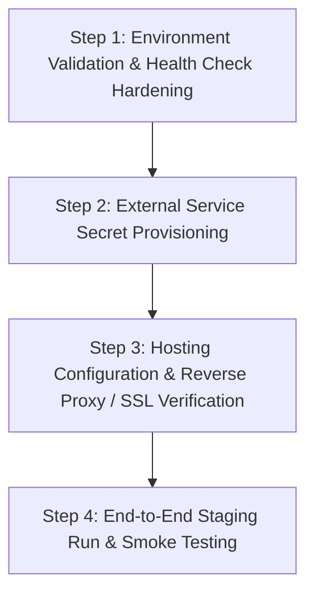

# VideoVerse — Phase 4, Step 3: Production Readiness & Deployment Preparation Audit

**Date:** November 15, 2026  
**Status:** AUDIT COMPLETED — NO CODE MODIFICATIONS PERFORMED  
**Auditor:** VideoVerse Core Engineering & Security Review

---

## 1. Executive Summary

This independent audit examines the operational and deployment readiness of VideoVerse for cloud hosting and production traffic. 
All core application features across Phases 1–4 are implemented and verified locally (**238/238 automated Jest tests passing, 0 ESLint errors, Vite production build successful in 7.20s**).

However, transitioning VideoVerse from a local/testing environment to a highly available, multi-instance, secure cloud deployment exposes specific operational gaps, third-party credentials requirements, and infrastructure considerations.

---

## 2. Production-Readiness Analysis by Domain

### 2.1 SMTP Email Delivery Configuration (OTP & Notifications)
- **Implementation Status:** FULLY IMPLEMENTED IN CODE with fallback.
- **Source Inspection:** [`server/utils/otpService.js`](file:///c:/Users/Asus/Downloads/videoverse/server/utils/otpService.js#L67-L139)
- **Current Behavior:**
  - Function `isSmtpConfigured()` verifies `SMTP_HOST`, `SMTP_USER`, and `SMTP_PASS`.
  - In `development` mode (`NODE_ENV !== 'production'`), if SMTP is absent, OTPs print to the console (`🔑 [DEV OTP]`).
  - In `production` mode (`NODE_ENV === 'production'`), if SMTP is unconfigured or fails, it logs `[SMTP Delivery Error]` and returns `{ sent: false, provider: 'none', error: 'SMTP not configured in production' }`.
- **Operational Blocker:**
  - In production, new device login requires OTP. If `SMTP_HOST`, `SMTP_PORT`, `SMTP_USER`, `SMTP_PASS`, and `SMTP_FROM` are not supplied in the production environment (e.g. via SendGrid, Mailgun, AWS SES, or Gmail App Password), **users on untrusted devices will not receive OTPs and cannot log in**.
- **Recommended Action:**
  - Configure production SMTP credentials in hosting platform environment settings.

---

### 2.2 Razorpay Production Configuration & Webhook Reliability
- **Implementation Status:** FULLY IMPLEMENTED IN CODE with fallback.
- **Source Inspection:** [`server/routes/payments.js`](file:///c:/Users/Asus/Downloads/videoverse/server/routes/payments.js#L80-L115), [`server/routes/payments.js`](file:///c:/Users/Asus/Downloads/videoverse/server/routes/payments.js#L780-L850)
- **Current Behavior:**
  - Orders are created server-side with strict tier-based pricing; signatures verified via HMAC-SHA256 (`RAZORPAY_KEY_SECRET`).
  - Webhook route `POST /api/payments/webhook` verifies `X-Razorpay-Signature` against `RAZORPAY_WEBHOOK_SECRET` and uses raw body capture.
  - Test mode mock triggers when `RAZORPAY_KEY_ID` contains `'REPLACE'`.
- **Operational Blocker:**
  - Production deployment currently requires live Razorpay API keys (`RAZORPAY_KEY_ID=rzp_live_...`, `RAZORPAY_KEY_SECRET=...`) and live `RAZORPAY_WEBHOOK_SECRET`.
  - The live webhook URL must be registered in the Razorpay Dashboard pointing to `https://<backend-domain>/api/payments/webhook` subscribing to `payment.captured` and `payment.failed`.
  - Client variable `VITE_RAZORPAY_KEY_ID` must match the public live key.

---

### 2.3 TURN Server Configuration for WebRTC Video Calling
- **Implementation Status:** FULLY IMPLEMENTED IN CODE with fallback.
- **Source Inspection:** [`server/utils/turnCredentials.js`](file:///c:/Users/Asus/Downloads/videoverse/server/utils/turnCredentials.js#L90-L156), [`server/routes/calls.js`](file:///c:/Users/Asus/Downloads/videoverse/server/routes/calls.js), [`client/src/hooks/useWebRTC.js`](file:///c:/Users/Asus/Downloads/videoverse/client/src/hooks/useWebRTC.js#L20-L50)
- **Current Behavior:**
  - Implements RFC 5766 / RFC 7635 dynamic REST credentials (`username: <timestamp>:<userId>`, HMAC-SHA1 signature).
  - Endpoint `GET /api/calls/ice-servers` returns STUN + dynamic TURN if `TURN_SERVER_URL` and `TURN_SHARED_SECRET` are set.
  - If unconfigured, falls back cleanly to Google public STUN (`stun:stun.l.google.com:19302`).
- **Operational Blocker:**
  - Public STUN works for direct NAT traversal but fails on symmetric NATs, cellular networks, and enterprise firewalls.
  - Without a configured coturn server or managed service (e.g. Xirsys, Metered, Twilio Network Traversal), a percentage of peer-to-peer WebRTC connections across different networks will experience connection timeouts (`ICE connection failed`).
- **Recommended Action:**
  - Supply `TURN_SERVER_URL` and `TURN_SHARED_SECRET` in production environment.

---

### 2.4 Environment Variable Validation & Secret Handling
- **Implementation Status:** FUNCTIONAL BUT SPREAD ACROSS MODULES.
- **Source Inspection:** [`server/config/db.js`](file:///c:/Users/Asus/Downloads/videoverse/server/config/db.js), [`server/index.js`](file:///c:/Users/Asus/Downloads/videoverse/server/index.js), [`server/routes/payments.js`](file:///c:/Users/Asus/Downloads/videoverse/server/routes/payments.js)
- **Current Behavior:**
  - `MONGODB_URI` throws at server startup if missing.
  - `JWT_SECRET` is checked during auth token generation and verification.
  - `RAZORPAY_KEY_ID` is checked lazily when orders are created.
  - `CLIENT_URL` controls CORS origins and cookie domain attributes.
- **Risk / Gap:**
  - There is no unified fail-fast boot-time environment validator (e.g. `validateEnv()`).
  - If a required secret (e.g., `JWT_SECRET`) is missing or too short in production, the server could boot up and only fail upon user requests.
- **Recommended Action:**
  - Add a centralized boot check in `server/config/validateEnv.js` that verifies required environment variables upon launch when `NODE_ENV === 'production'`.

---

### 2.5 Database Backup, Recovery & Indexing Strategies
- **Implementation Status:** CORE INDEXES PRESENT IN SCHEMAS.
- **Source Inspection:** [`server/models/`](file:///c:/Users/Asus/Downloads/videoverse/server/models/)
- **Index Inventory:**
  - `User`: `email` (unique), `username` (indexed).
  - `Comment`: `videoId` (indexed), `createdAt` (indexed), `parentId` (indexed), `isDeleted` (indexed).
  - `Notification`: `{ recipient: 1, commentId: 1, type: 1 }` (unique compound), `recipient: 1, createdAt: -1`.
  - `Payment`: `razorpayOrderId` (unique, sparse), `userId: 1, createdAt: -1`.
  - `PaymentIntent`: `razorpayOrderId` (unique).
  - `WebhookLog`: `eventId` (unique, sparse).
  - `Download`: `userId: 1, videoId: 1`, `tokenHash` (unique, sparse).
  - `UploadSession`: `uploadId` (unique).
  - `TranscodeJob`: `jobId` (unique), `status: 1`.
- **Infrastructure Strategy:**
  - MongoDB Atlas provides automated daily snapshots and Point-In-Time Recovery (PITR).
  - Verify that MongoDB connection string (`MONGODB_URI`) uses connection pooling (`maxPoolSize=50`).

---

### 2.6 Production Logging, Error Monitoring & Health Checks
- **Implementation Status:** BASIC IMPLEMENTATION.
- **Source Inspection:** [`server/index.js`](file:///c:/Users/Asus/Downloads/videoverse/server/index.js#L188-L203)
- **Current Behavior:**
  - `GET /api/health` returns `{ status: 'ok', timestamp, version }`.
  - Logs are written to stdout/stderr via `console.log` / `console.error`.
- **Gaps:**
  - `GET /api/health` does not check database connectivity (`mongoose.connection.readyState === 1`). If MongoDB drops, `/api/health` still reports `ok`.
  - Lack of structured logging (e.g., JSON logs for Datadog, Grafana Loki, CloudWatch) or an error tracker (e.g., Sentry).
- **Recommended Action:**
  - Enhance `/api/health` to perform a lightweight probe on `mongoose.connection.readyState` and return 503 if disconnected.

---

### 2.7 Deployment Configuration, Hosting & HTTPS Requirements
- **Frontend Hosting:**
  - [`client/vercel.json`](file:///c:/Users/Asus/Downloads/videoverse/client/vercel.json) rewrites `/api/:path*` to `https://videoverse-yyah.onrender.com/api/:path*` and catches all other routes to `/index.html`.
  - Note: In [`client/vercel.json`](file:///c:/Users/Asus/Downloads/videoverse/client/vercel.json#L7), the backend destination URL is currently hardcoded to `videoverse-yyah.onrender.com`. If deploying to a new backend URL, this rewrite destination must be updated.
- **Backend Hosting:**
  - Node.js server with Express + Socket.IO.
  - Express server trusts 1 reverse proxy hop (`app.set('trust proxy', 1)`).
  - Cookies use `sameSite: 'lax'`, `secure: true` in production, and `httpOnly: true`.
- **WebSocket Traversal:**
  - On platforms like Render or Railway, sticky sessions or single-instance scaling is required for Socket.IO unless a Redis adapter (`@socket.io/redis-adapter`) is added for horizontal multi-instance scaling.

---

### 2.8 Media Storage Scalability & Cleanup Worker Reliability
- **Implementation Status:** LOCAL DISK STORAGE IMPLEMENTED.
- **Source Inspection:** [`server/utils/videoProcessor.js`](file:///c:/Users/Asus/Downloads/videoverse/server/utils/videoProcessor.js), [`server/utils/hlsTranscoder.js`](file:///c:/Users/Asus/Downloads/videoverse/server/utils/hlsTranscoder.js), [`server/utils/cleanupWorker.js`](file:///c:/Users/Asus/Downloads/videoverse/server/utils/cleanupWorker.js)
- **Current Architecture:**
  - Videos and HLS playlists/segments (`.m3u8`, `.ts`) are written to local directories under `uploads/` and `storage/`.
  - Downloaded watermarked files are cleaned up every hour by `cleanupWorker.js`.
  - Abandoned upload chunks are purged by `uploadCleanup.js`.
- **Production Scalability Limitation:**
  - Local disk storage is ephemeral on serverless or dyno-based platforms (Render free tier, Heroku) without attached persistent disks (e.g. Render Persistent Disks, AWS EBS, AWS S3/CloudFront).
  - For true horizontal scaling across multiple web instances, media storage must eventually use cloud object storage (AWS S3, Google Cloud Storage, or Cloudflare R2).

---

## 3. Prioritized Production Deployment Checklist

### Tier 1: Critical Deployment Blockers (Must configure before launch)
1. **MongoDB Atlas URI (`MONGODB_URI`)**:
   - Live production MongoDB cluster with IP access whitelist (allow cloud provider IPs or `0.0.0.0/0` with strong authentication).
2. **JWT Secret (`JWT_SECRET`)**:
   - Set high-entropy random string (at least 64 hex characters) in production.
3. **Frontend CORS & Cookies (`CLIENT_URL`)**:
   - Point `CLIENT_URL` to the production frontend domain (e.g., `https://videoverse.vercel.app`).
4. **Update Frontend API Destination**:
   - Update `destination` in [`client/vercel.json`](file:///c:/Users/Asus/Downloads/videoverse/client/vercel.json#L7) or set `VITE_API_BASE_URL` to the production backend URL.
5. **SMTP Configuration (`SMTP_*`)**:
   - Configure `SMTP_HOST`, `SMTP_PORT`, `SMTP_USER`, `SMTP_PASS`, `SMTP_FROM` for OTP verification emails.
6. **Razorpay Live Keys & Webhook**:
   - `RAZORPAY_KEY_ID`, `RAZORPAY_KEY_SECRET`, `RAZORPAY_WEBHOOK_SECRET`, and `VITE_RAZORPAY_KEY_ID`.
   - Register webhook endpoint `https://<backend-url>/api/payments/webhook`.

### Tier 2: High Reliability & Security Improvements
1. **Database Health Check**:
   - Update `GET /api/health` to verify `mongoose.connection.readyState`.
2. **Boot-Time Environment Validator**:
   - Fail fast on server boot if essential production environment variables are missing.
3. **TURN Server Relay**:
   - Configure `TURN_SERVER_URL` and `TURN_SHARED_SECRET` for 100% video calling reliability across symmetric NATs.

### Tier 3: Scalability & Infrastructure Enhancements
1. **Persistent Cloud Storage**:
   - Mount persistent volume on Render/Railway or transition upload chunk storage and HLS directory to S3/CloudFront.
2. **Socket.IO Redis Adapter**:
   - Add Redis adapter if horizontally scaling the backend to multiple container instances.

---

## 4. Recommended Implementation Sequence

1. **Phase 4, Step 4:** Implement boot-time environment variable validation (`validateEnv.js`) and database-aware health check endpoint.
2. **Phase 4, Step 5:** Final verification of deployment configuration (`vercel.json`, headers, CORS) and preparation of deployment runbooks.
