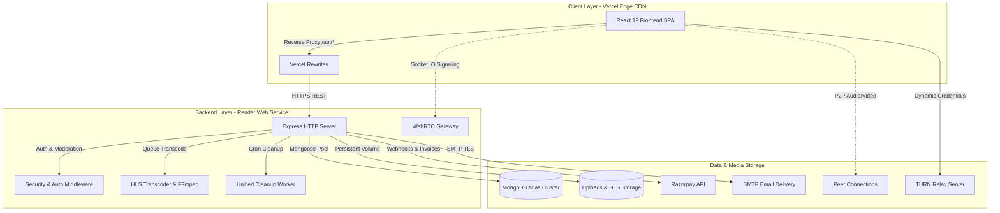

# 🎬 VideoVerse — Next-Generation Multilingual Video & Real-Time Streaming Platform

[]()
[]()
[]()
[]()

> **VideoVerse** is a production-ready, full-stack video streaming and real-time collaboration web platform built with React 19, Node.js, Express, Socket.IO, WebRTC, and MongoDB. It features end-to-end multi-bitrate HLS transcoding, user-watermarked video downloads, multilingual comments with real-time translation, nested reply hierarchies with interactive `@username` mentions, multi-party video conferencing, and automated subscription billing via Razorpay.

---

## 🌐 Live Production Deployments

- **Live Application (Frontend - Vercel):** [https://videoverse-km6v.vercel.app](https://videoverse-km6v.vercel.app)
- **Production API & Health Check (Backend - Render):** [https://videoverse-yyah.onrender.com/api/health](https://videoverse-yyah.onrender.com/api/health)
- **GitHub Repository (`main` branch):** [https://github.com/anu-coder-pixel/videoverse](https://github.com/anu-coder-pixel/videoverse)

---

## 🚀 Key Features

### 1. 🎥 Adaptive Video Streaming & HLS Transcoding
- **Automatic Multi-Bitrate Ladder:** Transcodes raw uploads into 1080p, 720p, 480p, and 360p HLS playlists (`.m3u8` and `.ts` segments) with background concurrency control.
- **Custom Video Player:** Resolution selector, playback speed controls (`0.5x` to `2x`), theater mode, subtitle track rendering, hover thumbnail scrub bar, and watch progress memory.
- **Resumable Uploads:** Chunk-based resumable file uploader with magic-byte MIME validation, size limits, and orphaned chunk auto-pruning.

### 2. 💬 Multilingual Community & Nested Mentions
- **Real-Time Translation:** On-demand comment and title translations powered by Google Translate API.
- **Nested Threading & Autocomplete:** Infinite reply nesting, chronological conversation tree display, interactive `@username` mention autocomplete dropdown with user safety projection, and in-app notification indicators.
- **Content Safety & Moderation:** Automated profanity filtering (English + Hinglish slurs and leetspeak variants), emoji flood suppression, link security validation, and comment reporting queue for administrators.

### 3. 🛡️ Controlled Downloads & Watermarking
- **Watermark Overlay:** Dynamic, semi-transparent burn-in of user identity (`user_***1234`) on downloaded MP4 frames via bundled FFmpeg `drawtext`.
- **Signed Download Tokens:** Cryptographic HMAC-SHA256 download links with 15-minute expiration windows and daily quota enforcement per subscription tier.

### 4. 📞 Real-Time WebRTC Video Conferencing
- **1-on-1 & Group Meetings:** Mesh WebRTC architecture supporting camera toggling, microphone controls, and noise suppression.
- **Dynamic Ephemeral TURN Authentication:** Generates RFC 5766 REST credentials with bounded TTL to guarantee NAT/firewall traversal.
- **Host & Co-host Moderation:** Room creator host privileges to mute participants, appoint co-hosts, and terminate meeting sessions.

### 5. 💳 Razorpay Subscriptions & PDF Invoicing
- **Server-Authoritative Billing:** Free, Bronze, Silver, and Gold tiers with monthly, quarterly, and annual billing cycles.
- **Webhook Reliability:** HMAC-SHA256 signature verification against raw buffers with atomic MongoDB idempotency transitions to prevent duplicate subscriptions.
- **Instant Tax Invoices:** Generates branded PDF receipts and tax invoices dynamically via PDFKit.

### 6. 🔐 Enterprise-Grade Security & Monitoring
- **Authentication & Trusted Devices:** HTTP-only JWT cookies (`vv_token`), device fingerprinting, session revocation, and uniform 6-digit email OTPs.
- **Fail-Fast Environment Validation:** Startup module (`server/config/validateEnv.js`) verifying secrets before opening HTTP ports.
- **Database-Aware Health Checks:** `/api/health` probes `mongoose.connection.readyState` returning `HTTP 200` (healthy) or `HTTP 503` (degraded).

---

## 🛠️ Technology Stack

| Layer | Technologies |
| :--- | :--- |
| **Frontend** | React 19, Vite 6, Hls.js, Lucide Icons, Vanilla CSS Design System |
| **Backend** | Node.js (>= 18), Express 4, Socket.IO 4, Mongoose 9 |
| **Media Pipeline** | Fluent-FFmpeg, `@ffmpeg-installer/ffmpeg`, `@ffprobe-installer/ffprobe` |
| **Security & Auth** | JSONWebTokens (JWT), Bcrypt.js, Helmet, Express-Rate-Limit, Crypto |
| **Payments & Invoicing**| Razorpay Node SDK, PDFKit, Nodemailer |
| **Database** | MongoDB Atlas (Multi-collection replica set with compound indexes) |
| **Testing** | Jest 30, Supertest, MongoDB Memory Server |
| **Deployment** | Vercel (Frontend Edge CDN & Proxy Rewrites), Render (Node.js Web Service) |

---

## 🏛️ System Architecture



---

## 📁 Repository Directory Structure

```text
videoverse/
├── client/                     # React 19 Vite frontend application
│   ├── src/
│   │   ├── components/         # Modular UI components (Navbar, Player, Comments, etc.)
│   │   ├── context/            # Global AppContext and CallContext state providers
│   │   ├── hooks/              # Custom hooks (useWebRTC, useGroupWebRTC, useVideos)
│   │   └── pages/              # Top-level view routes (HomePage, WatchPage, CallPage, AdminPage)
│   ├── vercel.json             # Vercel production routing and API proxy rewrites
│   └── vite.config.js          # Vite configuration and development proxy
├── server/                     # Node.js Express backend and Socket.IO gateway
│   ├── config/                 # DB connection and startup validateEnv validator
│   ├── middleware/             # Authentication, role-based access, and rate limiters
│   ├── models/                 # Mongoose schema definitions (User, Video, Comment, etc.)
│   ├── routes/                 # Express API endpoints (auth, upload, payments, calls, admin)
│   ├── socket/                 # Real-time WebRTC signaling gateway
│   ├── tests/                  # 15 automated Jest test suites (247 tests)
│   └── utils/                  # FFmpeg transcoder, watermarking, cleanup worker, OTP service
├── scripts/                    # Database maintenance and sync scripts
├── docs/                       # Project audits and technical documentation
│   ├── phase-reports/          # Step-by-step milestone delivery reports (Phases 1-4)
│   ├── security/               # Security audits, threat analyses, and missing feature checks
│   ├── deployment/             # Deployment audits, runbooks, and environment checklists
│   └── test-results/           # Verified regression logs and traceability matrices
├── .gitignore                  # Strict Git ignore rules for secrets and media binaries
├── package.json                # Root workspace configuration
└── README.md                   # Main project documentation
```

---

## ⚙️ Local Installation & Development Setup

### Prerequisites
- **Node.js** (v18.0.0 or higher recommended)
- **npm** (v9.0.0 or higher)
- **MongoDB** (Local instance or free MongoDB Atlas URI)

### 1. Clone the Repository
```bash
git clone https://github.com/anu-coder-pixel/videoverse.git
cd videoverse
```

### 2. Install Dependencies
```bash
# Install root dependencies
npm install

# Install server dependencies
cd server && npm install

# Install client dependencies
cd ../client && npm install
cd ..
```

### 3. Environment Configuration
Duplicate the environment template files and fill in your local development values:

```bash
# Server configuration
cp server/.env.example server/.env

# Client configuration
cp client/.env.example client/.env
```

#### Minimal `server/.env` for Local Development:
```ini
PORT=5000
NODE_ENV=development
MONGODB_URI=mongodb://127.0.0.1:27017/videoverse
JWT_SECRET=your_super_secret_jwt_key_at_least_32_characters_long
CLIENT_URL=http://localhost:5173
```

#### Minimal `client/.env` for Local Development:
```ini
VITE_RAZORPAY_KEY_ID=rzp_test_placeholder_key_id
```

### 4. Seed Initial Video Data (Optional)
```bash
cd server && npm run seed && cd ..
```

### 5. Run the Application
In two separate terminals:

```bash
# Terminal 1: Start Backend API & WebRTC Signaling
cd server && npm run dev

# Terminal 2: Start Frontend Development Server
cd client && npm run dev
```

Open your browser at `http://localhost:5173`.

---

## 🧪 Automated Testing & Code Quality

VideoVerse is covered by an automated test suite verifying every route, security policy, media processing worker, and WebRTC gateway:

```bash
# Run full Jest test suite across all 15 suites
npx jest --runInBand --forceExit

# Run frontend linting
npm --prefix client run lint

# Run frontend production build
npm --prefix client run build
```

### Verified Test Suite Summary:
```text
Test Suites: 15 passed, 15 total
Tests:       247 passed, 247 total (100% pass rate)
ESLint:      0 errors
Vite Build:  Clean production build
```

---

## 📚 Technical Documentation & Milestone Reports

All design specifications, audit logs, and operational runbooks are organized in [`docs/`](./docs):

- **Deployment Runbook:** [`docs/deployment/VIDEOVERSE_PRODUCTION_RUNBOOK.md`](./docs/deployment/VIDEOVERSE_PRODUCTION_RUNBOOK.md)
- **Environment Checklist:** [`docs/deployment/FINAL_ENVIRONMENT_CHECKLIST.md`](./docs/deployment/FINAL_ENVIRONMENT_CHECKLIST.md)
- **Final Test Evidence:** [`docs/test-results/FINAL_TEST_RESULTS.md`](./docs/test-results/FINAL_TEST_RESULTS.md)
- **Security Audit:** [`docs/security/PHASE_4_SECURITY_AUDIT.md`](./docs/security/PHASE_4_SECURITY_AUDIT.md)
- **Requirements Traceability Matrix:** [`docs/test-results/PROJECT_IMPLEMENTATION_AUDIT.md`](./docs/test-results/PROJECT_IMPLEMENTATION_AUDIT.md)

---

## 📄 License
This project is licensed under the [MIT License](LICENSE).
