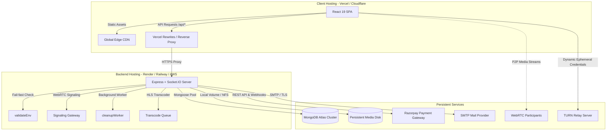
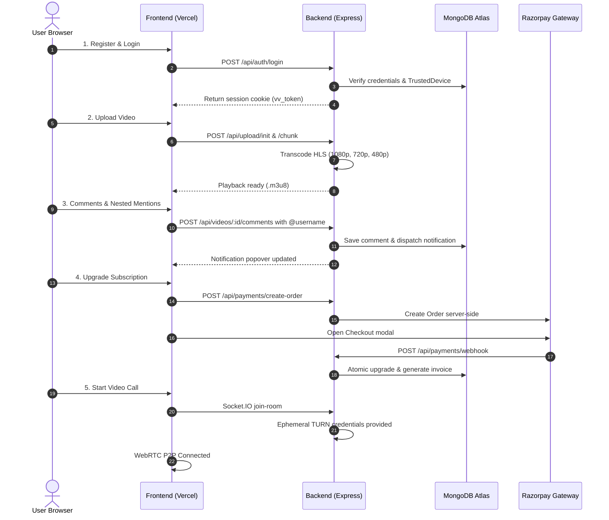

# VideoVerse — Production Deployment & Operations Runbook

This runbook outlines the step-by-step procedures for deploying, maintaining, monitoring, and scaling the VideoVerse application in production.

---

## 1. Architecture Overview



---

## 2. Pre-Deployment Setup & Provisioning

### Step 1: Provision Persistent Database (MongoDB Atlas)
1. Create a dedicated Production Project in MongoDB Atlas.
2. Deploy an `M10` or higher cluster with automated daily snapshots and point-in-time recovery.
3. In **Network Access**, whitelist your backend IP or add `0.0.0.0/0` with strong SCRAM-SHA-256 database user credentials.
4. Obtain the connection string: `mongodb+srv://<username>:<password>@cluster0.xxx.mongodb.net/videoverse?retryWrites=true&w=majority`.

### Step 2: Provision Media Disk Storage
- Because VideoVerse stores original videos, chunk assemblies, and adaptive HLS playlists (`.m3u8` and `.ts`), **persistent storage is mandatory**:
  - **On Render:** Attach a Render Persistent Disk mounted to `/opt/render/project/src/server/uploads` (min 20 GB recommended).
  - **On Railway:** Add a Persistent Volume mounted at `/app/server/uploads`.
  - **On AWS ECS/EC2:** Mount an Amazon EFS or EBS volume to `server/uploads`.

### Step 3: Provision Third-Party Services
1. **SMTP Mail Delivery:**
   - Create an account with SendGrid, Amazon SES, or Mailgun.
   - Verify domain SPF, DKIM, and DMARC records to ensure OTP emails do not land in spam.
   - Generate an SMTP API Key.
2. **Razorpay Live Gateway:**
   - Complete KYC and switch from Test Mode to Live Mode in Razorpay Dashboard.
   - Generate Live API Keys (`rzp_live_...`).
   - Register Webhook URL: `https://<backend-domain>/api/payments/webhook` subscribing to `payment.captured` and `payment.failed`. Generate a Webhook Secret.
3. **WebRTC TURN Server:**
   - Deploy a Coturn instance or configure a managed TURN service (e.g., Metered, Xirsys, Twilio).
   - Configure the static shared secret matching `TURN_SHARED_SECRET`.

---

## 3. Deployment Procedures

### Backend Deployment (e.g. Render / Railway / Docker)

1. **Build Command:**
   ```bash
   cd server && npm install --omit=dev
   ```
2. **Start Command:**
   ```bash
   cd server && npm start
   ```
3. **Configure Environment Variables:**
   Add all required variables specified in [`VIDEOVERSE_ENVIRONMENT_CHECKLIST.md`](file:///c:/Users/Asus/Downloads/videoverse/VIDEOVERSE_ENVIRONMENT_CHECKLIST.md).
4. **Health Check Path:**
   Configure provider health probe to `GET /api/health` with a 30-second interval and 5-second timeout.
5. **Verify Boot:**
   Check server deployment logs for:
   ```
   ✅ MongoDB connected successfully: ...
   🚀 VideoVerse API & Signaling running at http://localhost:5000
   ```

### Frontend Deployment (e.g. Vercel)

1. **Update API Destination in `client/vercel.json`:**
   ```json
   {
     "rewrites": [
       {
         "source": "/api/:path*",
         "destination": "https://<your-actual-backend-domain>/api/:path*"
       },
       {
         "source": "/(.*)",
         "destination": "/index.html"
       }
     ]
   }
   ```
2. **Build Settings:**
   - Root Directory: `client`
   - Build Command: `npm run build`
   - Output Directory: `dist`
3. **Environment Variables:**
   - `VITE_RAZORPAY_KEY_ID`: `rzp_live_...`
   - `VITE_API_BASE_URL`: (optional if using rewrites)
4. **Deploy:**
   Trigger deployment via Git push or Vercel CLI.

---

## 4. Production Smoke Test Verification Plan

After deployment, perform this end-to-end verification sequence:



### Detailed Smoke Test Steps:
1. **System Health Probe:**
   - Send `GET https://<backend>/api/health`.
   - Assert response is `200 OK` with `"database": "connected"`.
2. **Authentication & Device Verification:**
   - Register a new account (`POST /api/auth/register`).
   - Clear cookies and log in from an incognito session.
   - Verify OTP is delivered via email and login succeeds upon entering code.
3. **Video Upload & Transcoding:**
   - Log in as creator, upload a test MP4 video through `UploadModal`.
   - Observe upload progress, chunk assembly, and background HLS transcoding.
   - Verify video plays smoothly via adaptive HLS streaming on `/watch/:id`.
4. **Social & Threaded Comments:**
   - Add a comment, reply to the comment, mention another user (`@username`).
   - Verify nested indentation, toggle replies button, and recipient in-app notification.
5. **Subscription & Invoicing:**
   - Purchase or upgrade plan.
   - Verify instant tier activation and download invoice PDF from Account page.
6. **Download Protection & Watermarking:**
   - Request download on a video. Verify daily quota decrements.
   - Verify downloaded MP4 contains user email watermark overlay.
7. **Video Calling & Moderation:**
   - Open Call page in two browser sessions.
   - Connect 1-on-1 and group call. Verify mic mute, camera toggle, in-call chat, and host mute controls.
8. **Admin Operations:**
   - Sign in as admin, navigate to `/admin`.
   - Check real-time analytics graphs, user list, video management, and audit logs.

---

## 5. Incident Response & Troubleshooting

| Symptom | Probable Cause | Action |
| :--- | :--- | :--- |
| **`/api/health` returns HTTP 503** | Database connection dropped or Atlas IP blocked. | Check MongoDB Atlas status and verify IP whitelist permits server IP. |
| **CORS errors in browser console** | `CLIENT_URL` does not match the frontend domain. | Update `CLIENT_URL` in backend env variables without trailing slash. |
| **Login fails with "SMTP transmission failed"** | Invalid SMTP credentials or outbound port 587 blocked. | Check SMTP provider logs and verify `SMTP_USER` and `SMTP_PASS`. |
| **Video upload chunk upload fails** | Disk space exhausted or write permissions missing. | Verify persistent volume mount status and available disk space (`df -h`). |
| **WebRTC video call hangs on "Connecting..."** | Symmetric NAT or firewall blocking direct P2P. | Verify `TURN_SERVER_URL` and `TURN_SHARED_SECRET` in backend configuration. |
| **Payment verified but tier not upgraded** | Webhook signature failure or amount mismatch. | Check `WebhookLog` collection in MongoDB for specific rejection reason. |

---

## 6. Routine Operations & Maintenance

- **Log Rotation:** Ensure hosting provider retains at least 14 days of application logs.
- **Automated Cleanup Worker:** The built-in worker runs every 30 minutes, removing chunks older than 12h, watermarked files older than 2h, and stale download reservations.
- **Database Backups:** Ensure Atlas daily snapshots are active with a minimum 7-day retention policy.
